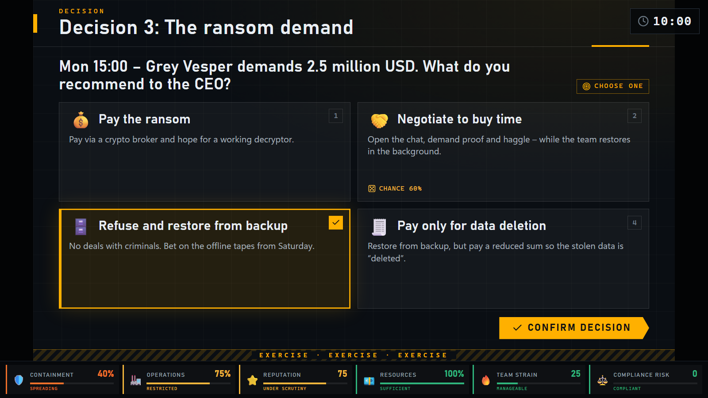
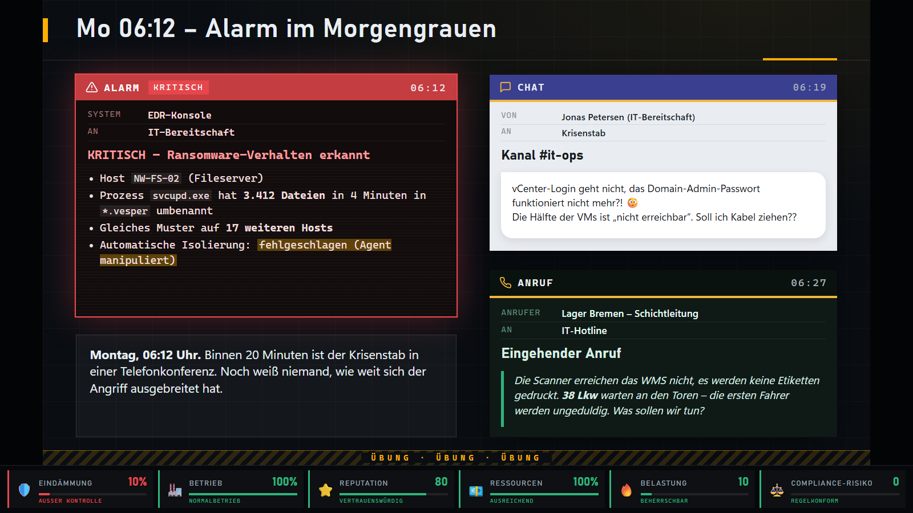
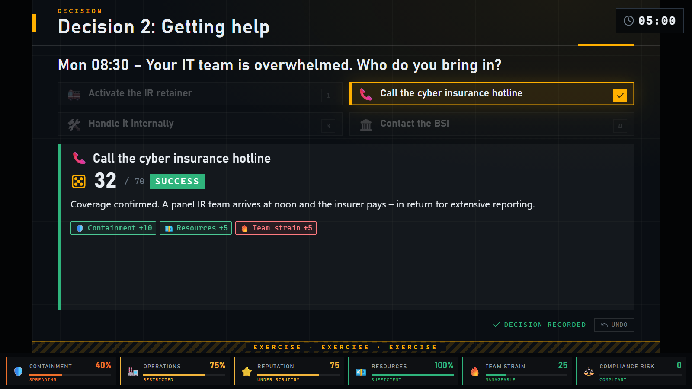
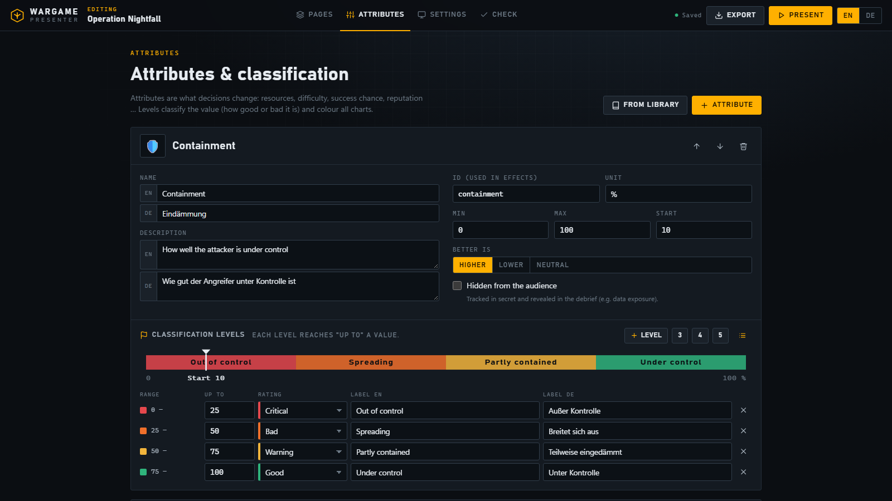
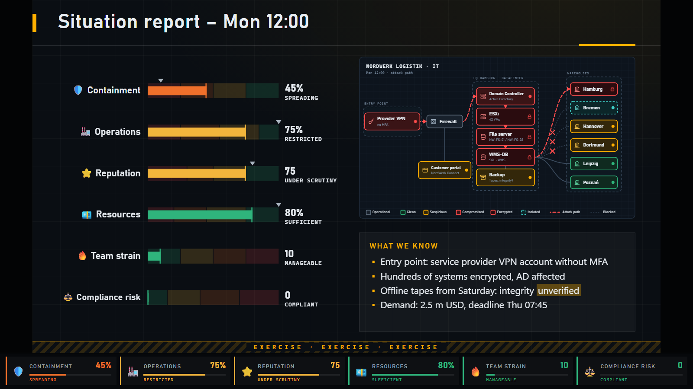
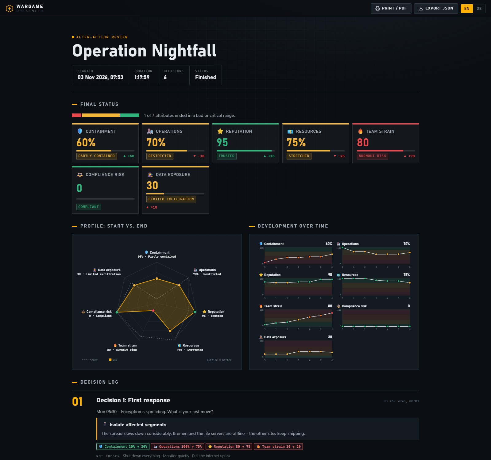
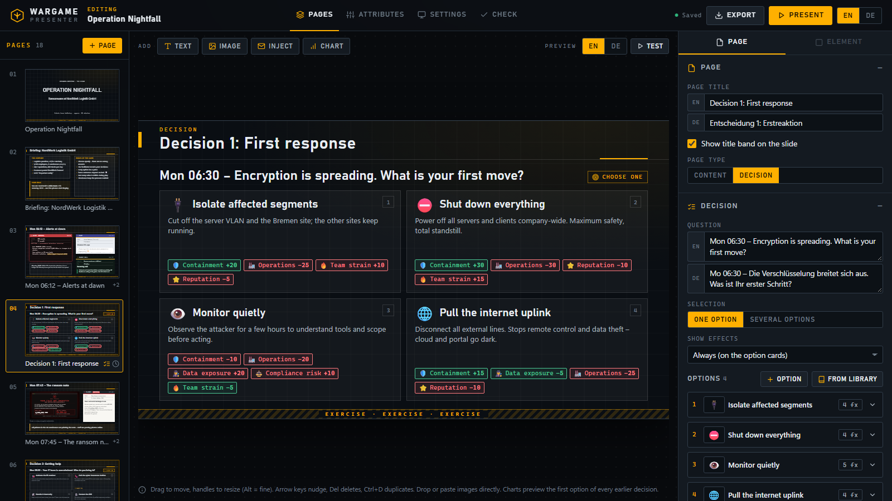

# Wargame Presenter

**Run cybersecurity wargames and tabletop exercises from one laptop in one room.**
Build a scenario from injects, decisions and attributes, put it on the projector, and watch every
choice the room makes move the numbers: containment, operations, reputation, budget, team strain …




- **Local and offline.** One Python file serves the app on `127.0.0.1`. No packages, no CDN, no
  account, no cloud. Everything is stored as plain JSON next to the app.
- **Made for one room.** One screen for the audience, one console for the facilitator, a clicker in
  your hand. No collaboration features, no logins, nothing to set up for participants.
- **Bilingual by design.** Every text, including attribute names and classification labels, exists
  in English and German. Switch the language live during the exercise with a single key.

> *Deutsch:* Lokale Web-App für Cyber-Planspiele und Tabletop-Übungen. Läuft offline auf dem
> Präsentationsrechner, braucht nur Python und speichert alles als JSON. Alle Inhalte sind
> zweisprachig (DE/EN) – mehr dazu [unten](#auf-deutsch).

---

## Contents

- [Quick start](#quick-start)
- [Features](#features)
- [Running an exercise](#running-an-exercise)
- [Building a scenario](#building-a-scenario)
- [Data, export and import](#data-export-and-import)
- [Project structure](#project-structure)
- [Requirements](#requirements)
- [Security notes](#security-notes)
- [Ideas and roadmap](#ideas-and-roadmap)
- [Auf Deutsch](#auf-deutsch)
- [License](#license)

## Quick start

```bash
git clone https://github.com/RAdosSantosJanuario/wargame-presenter.git
cd wargame-presenter
python server.py
```

On Windows you can also double-click **`start.bat`**. Your browser opens at
<http://127.0.0.1:8765>.

On first start the sample scenario **Operation Nightfall** is imported: a ransomware attack on a
fictional German logistics company, with 18 pages, 6 decisions, branching, dice rolls, a live
network map and a hidden "data exposure" score. Press **Present** to try it, or **Edit** to see how it is built.

| Option | Default | Meaning |
| --- | --- | --- |
| `--port 9000` | `8765` | Port to listen on |
| `--data D:\exercise` | `./data` | Folder for wargames, images and sessions |
| `--no-browser` | off | Don't open the browser automatically |
| `--host 0.0.0.0` | `127.0.0.1` | Make it reachable from other devices (see [security notes](#security-notes)) |
| `--allow-host laptop01` | none | Also accept this host name, e.g. when other devices open `http://laptop01:8765` (repeatable) |

## Features

### Presenting

- **Projector view.** 16:9 slides that scale to any screen, plus an attribute bar at the bottom that
  animates and flashes the change after every decision.
- **Presenter console** (key **P**) for your laptop screen. It shows the current and next slide,
  your facilitator notes, a countdown timer, the decision controls and *all* values, including
  hidden ones. Both windows stay in sync and either can drive the exercise.
- **Clicker friendly.** Works with arrow keys and PgUp/PgDn. Also has a black screen, fullscreen,
  live language switch and a timer per decision.
- **Step-by-step reveals.** Injects can appear one after another, like slide animations.
- **Undo built in.** Going back undoes the decision of the page you leave, and **U** undoes the
  decision on the current page.
- **Never lose a session.** Every change is saved. After a crash or reload, the exercise resumes
  exactly where it was.

| Injects (here in German) | Dice roll on a risky option |
| --- | --- |
|  |  |

### Decisions and consequences

- **Single or multiple choice**, with a minimum and maximum number of options.
- **Effects.** Each option changes any number of attributes, for example *containment +20,
  operations −25, team strain +10*.
- **Risky options.** An option can have a success chance (e.g. 60 %). A dice roll then decides
  between the success branch and a separate failure branch, each with its own effects and outcome
  text.
- **Branching.** Options can jump to a specific page, and pages can be **conditional**: *show only
  if reputation < 50* or *only if "pay ransom" was chosen*.
- **Effect display.** Show the effects never, after the decision, or right on the option cards.

### Attributes and classification

- Define your own attributes, such as resources, difficulty, success chance or costs, with unit,
  min, max, start value and whether **higher or lower is better**.
- **Classification levels** say up to which value an attribute is *critical, bad, warning,
  acceptable* or *good*, with your own label for each level in both languages. These levels color
  every chart and the attribute bar.
- **Hidden attributes** are tracked secretly and only revealed in the debrief, e.g. how much data
  was really exfiltrated.



### Network maps that react to decisions

- **Live network map element.** Place systems (server, firewall, VPN, site, backup …) with a status,
  connect them, and group them in zones such as *HQ datacenter* or *warehouses*.
- **Statuses and lines.** Systems can be operational, clean, unknown, suspicious, compromised,
  encrypted, isolated or offline. Connections can be normal, an animated **attack path**,
  suspicious traffic, or blocked. The legend is generated automatically.
- **It follows the exercise.** Each system and connection can change during the game with the same
  rules as conditional pages. Example: *Bremen becomes "isolated" and its WAN link "blocked" when the
  room chose "Isolate affected segments"*.
- **Visual editor.** Drag systems and zones, Shift+click to connect, and preview the map at the start
  or after the decisions.

### Charts and debrief

- **Seven chart types** you can place on any slide: bars with level bands, gauges, radar (start vs.
  now), timeline (small multiples), stat cards, the changes from the last decision, and the decision
  log.
- **After-action review** for every session: final status, profile, development over time, and
  every decision with its outcome, dice roll and before/after values. Printable as PDF, exportable
  as JSON.

| Situation report with live network map | After-action review |
| --- | --- |
|  |  |

### Authoring

- **Free-form slide editor.** Drag elements anywhere and resize them with handles. Arrow keys nudge,
  **Ctrl+D** duplicates, and images can be pasted (**Ctrl+V**) or dropped straight onto the slide.
- **Undo everything.** **Ctrl+Z** undoes and **Ctrl+Y** redoes any change in the editor, including in
  the network editor (buttons in the top bar too).
- **Element types:** text (simple markdown), images, **injects** styled as e-mail, phone call, chat,
  SMS, news article, social media post, SIEM/EDR alert or memo, network maps, charts, and option
  cards.
- **Text that fits.** Text that is too long for its box shrinks automatically, so the German version
  fits as well as the English one.
- **Libraries.** 34 typical incident-response options (isolate segments, pay the ransom, notify the
  BSI / data protection authority / NIS2, press statement, restore from backup, shift rotation …)
  and 10 ready-made attributes. Each has suggested effects and can be inserted with one click.
- **Consistency check.** Lists missing translations, jumps to deleted pages, unknown attributes and
  other mistakes, each with a link to the problem.
- **Look and feel.** Dark "ops room" or light "briefing paper" theme, accent color, and a marking
  strip on every slide (*EXERCISE / ÜBUNG*, *TLP:AMBER* …).
- **Test mode.** Start the presentation from any page without recording a session.



## Running an exercise

1. In the library, click **Present** on a wargame.
2. Move the window to the projector and press **F** for fullscreen.
3. Press **P** to open the presenter console. Keep it on your laptop screen, in the **same browser**,
   because the two windows talk to each other directly inside the browser.
4. Walk through the injects. On a decision page, let the room discuss, select the options with the
   mouse or **1–9**, and confirm with **Enter**.
5. At the end, open **Debrief** for the after-action review, or find it later in the library under
   *Sessions*.

| Key | Action |
| --- | --- |
| **→**, **Space**, **PgDn** | next reveal step / next page |
| **←**, **PgUp** | back (undoes the decision of the page you leave) |
| **1 – 9** | select an option |
| **Enter** | confirm the decision |
| **U** | undo the decision on this page |
| **L** | switch language EN ⇄ DE |
| **H** | show / hide the attribute bar |
| **T** / **R** | start-pause / reset the countdown |
| **B** or **.** | black screen |
| **F** | fullscreen |
| **P** | open the presenter console |
| **?** | show all shortcuts |
| **Esc** | end the presentation (the session stays saved) |

On a decision page, **Next** first asks for a decision. Pressing it a second time skips the decision.

In the editor: **Ctrl+Z** / **Ctrl+Y** undo and redo, **Ctrl+S** saves immediately (it also saves
automatically), **Del** deletes the selected element, **Ctrl+D** duplicates it, arrow keys nudge it
(**Shift** = bigger steps), **PgUp/PgDn** switch pages. In the network editor, **C** toggles connect
mode.

## Building a scenario

A wargame has three parts, each with its own tab in the editor:

- **Pages:** the slides. Add a page from a template (title, text, inject, image, decision,
  situation report, debrief, blank), then add or move elements on it. The inspector on the right
  edits the selected page or element. Every text field has an **EN** and a **DE** line; a missing
  translation is highlighted. Double-click a network map to open the network editor.
- **Attributes:** what decisions change, and how each value is classified.
- **Settings:** title, description, theme, accent color, start language and marking strip.

A typical flow for one round:

```
Inject page (alert, call, e-mail …)  →  Decision page (options with effects)
        →  [conditional page, e.g. "data appears on leak site" if exposure > 25]
        →  Situation report (chart of the current values)
```

The full data model, with every field, is documented in [`docs/FORMAT.md`](docs/FORMAT.md).

## Data, export and import

Everything lives in plain files:

```
data/
├── wargames/<id>.json   one file per wargame
├── media/<id>/          uploaded images
├── runs/<runId>.json    recorded sessions (decisions, values over time, copy of the wargame)
└── trash/               deleted wargames are moved here, not destroyed
```

- **Export** (download icon in the library, or *Export* in the editor) produces a single
  `.wargame.json` file that contains the wargame **and its images**. Send it to a colleague or keep
  it in version control.
- **Import** with the *Import* button, or drop the file anywhere on the library page.
- **Back up** by copying the `data/` folder. It is excluded from git by `.gitignore`.

## Project structure

```
server.py              local web server and JSON API (Python standard library only)
start.bat              double-click starter for Windows
samples/               sample scenario, imported on first start
docs/FORMAT.md         data format reference
static/
├── index.html
├── css/app.css        all styles, including slide themes and inject designs
└── js/
    ├── main.js        router
    ├── engine.js      session logic: navigation, decisions, dice, undo, timer
    ├── model.js       data model, classification, conditions, validation
    ├── render.js      renders a slide (used by projector, editor, console)
    ├── charts.js      SVG/HTML charts and the attribute bar
    ├── i18n.js        UI texts in English and German
    ├── templates.js   option and attribute library
    └── views/         library, editor, presentation, presenter console, debrief
```

No build step: edit a file and reload the page.

## Requirements

- **Python 3.8 or newer.** Nothing to install with pip.
- **A current browser:** Chrome, Edge, Firefox or Safari (2023 or newer). The app uses CSS
  container queries and `BroadcastChannel`.
- Fonts come from the operating system (Bahnschrift, Segoe UI, Cascadia on Windows), with
  fallbacks elsewhere. No web fonts are downloaded.

## Security notes

- The server listens on **127.0.0.1** by default, so only the computer it runs on can reach it.
- There is **no login and no access control**. If you start it with `--host 0.0.0.0`, anyone on the
  same network can view *and change* your wargames. Only do that on a network you trust.
- Uploaded files are limited to images and stored under `data/media/`. Requests with paths that try
  to leave the data folder are rejected.
- **Other web pages in the same browser cannot use the API.** The server only answers requests whose
  `Host` header is `localhost`, an IP address or a name given with `--allow-host`, which blocks
  DNS rebinding. Writes from another origin are rejected, and POST/PUT must be sent as
  `application/json`, so a page cannot slip in a "simple" cross-site request without a preflight.
- The sample scenario and its company are fictional.

## Ideas and roadmap

- Several teams playing the same scenario in parallel, compared side by side in the debrief
- "Wildcard" injects the facilitator can trigger at any time
- Scoring against an expected "gold path" defined by the author
- Optional audience voting from phones

Contributions and ideas are welcome. Please open an issue first for larger changes.

## Auf Deutsch

**Wargame Presenter** ist eine lokale Web-App, um Cyber-Planspiele und Tabletop-Übungen in einem
Raum durchzuführen. Sie läuft auf dem Präsentationsrechner, braucht nur Python (keine Pakete, kein
Internet) und speichert alles als JSON.

- **Start:** `python server.py` oder Doppelklick auf `start.bat`. Der Browser öffnet sich unter
  <http://127.0.0.1:8765>.
- **Präsentieren:** Präsentationsfenster auf den Beamer ziehen und mit **F** auf Vollbild schalten.
  Mit **P** öffnet sich die Moderatorenansicht mit Notizen, Vorschau, Timer und allen Werten.
- **Entscheidungen** verändern frei definierbare Attribute. Riskante Optionen werden ausgewürfelt,
  Seiten können verzweigen oder nur unter Bedingungen erscheinen.
- **Bewertungsstufen** legen fest, bis zu welchem Wert ein Attribut *kritisch*, *schlecht*,
  *Warnung*, *akzeptabel* oder *gut* ist. Verdeckte Attribute werden erst in der Nachbesprechung
  aufgedeckt.
- **Zweisprachig:** Alle Inhalte haben ein deutsches und ein englisches Feld. Mit **L** wechselt die
  Sprache live. Die Oberfläche lässt sich oben rechts umschalten.
- **Export/Import** als eine einzige `.wargame.json`-Datei inklusive Bilder.

## License

[MIT](LICENSE) © 2026 Robin dos Santos
